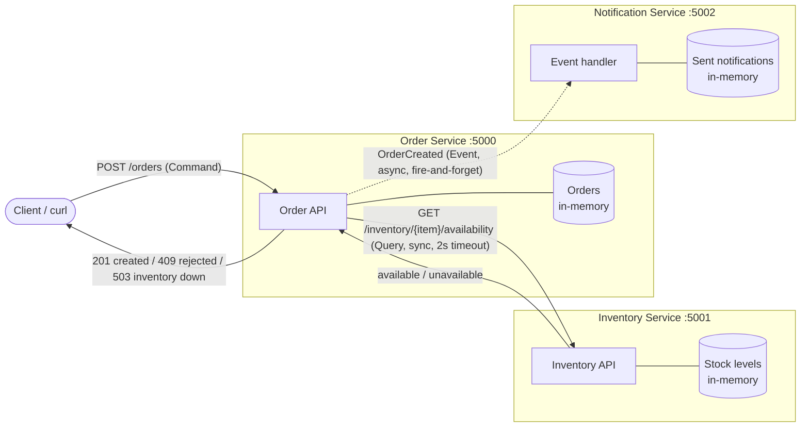

# Online Store: A Small Distributed Application

A simple online store split into three independent Python services. Each service is its own process, owns its own data and talks to the others over HTTP/JSON.

| Service | Port | Role |
| --- | --- | --- |
| Order Service | 5000 | Creates and tracks orders |
| Inventory Service | 5001 | Tracks item availability |
| Notification Service | 5002 | Notifies users when an order is created |

The required interaction, **Order Service → Inventory Service**, is fully implemented and includes failure handling. The Notification Service is a lightweight consumer of the `OrderCreated` event, so all three responsibilities are represented.

---

## 1. Installation and running

**Requirements:** Python 3.9+ and `curl`.

```bash
git clone <your-repo-url>
cd online-store

python3 -m venv .venv
source .venv/bin/activate          # Windows: .venv\Scripts\activate
pip install -r requirements.txt    # flask, requests
```

Start each service in its **own terminal** (three independent processes):

```bash
# Terminal 1 - Inventory Service (port 5001)
python3 inventory_service/app.py

# Terminal 2 - Notification Service (port 5002)
python3 notification_service/app.py

# Terminal 3 - Order Service (port 5000)
python3 order_service/app.py
```

The Order Service finds the other services through these environment variables. Both are optional:

| Variable | Default |
| --- | --- |
| `INVENTORY_URL` | `http://127.0.0.1:5001` |
| `NOTIFICATION_URL` | `http://127.0.0.1:5002` |

### API

| Method | Endpoint | Service | Type |
| --- | --- | --- | --- |
| `POST` | `/orders` (body: `{"item_id", "quantity", "customer"}`) | Order | Command |
| `GET` | `/orders/<order_id>` | Order | Query |
| `GET` | `/inventory/<item_id>/availability?quantity=N` | Inventory | Query |
| `POST` | `/events/order-created` | Notification | Event consumer |
| `GET` | `/health` | All | Health check |

Sample inventory (in memory): `laptop: 5`, `mouse: 20`, `keyboard: 0`, `monitor: 2`.

---

## 2. Architecture



**Flow for one order:**

1. The client sends a **command** to the Order Service: `POST /orders`.
2. The Order Service sends a **query** to the Inventory Service: is the item available?
3. The Inventory Service answers `available` or `unavailable`.
4. The Order Service responds to the client:
   - **201** if the order was created
   - **409** if the item is unavailable
   - **503** if the Inventory Service cannot be reached
5. If the order was created, the Order Service publishes an **`OrderCreated` event** to the Notification Service in a background thread, so the client never waits on it.

### Component responsibilities

| Service | Responsibility |
| --- | --- |
| **Order Service** | Entry point for customers. Validates order requests, asks Inventory whether the item can be supplied, creates and stores the order, lets customers track it, and announces new orders with an `OrderCreated` event. |
| **Inventory Service** | Single source of truth for stock. Answers availability queries for an item and quantity. It knows nothing about orders or customers. |
| **Notification Service** | Reacts to `OrderCreated` events and notifies the user. Email/SMS is simulated with a log line. It never calls the other services. |

### Data ownership

| Service | Owns | Does **not** own |
| --- | --- | --- |
| Order | Orders: `order_id`, customer, `item_id`, quantity, status, timestamp | Stock levels, notification history |
| Inventory | Items and stock counts (`item_id → quantity`) | Orders, customers |
| Notification | Notifications sent (order id + message) | Orders, stock |

Each service keeps its data in its own process memory. No service reads another service's data directly; it can only ask through that service's API. In production each would have its own database.

### Why these service boundaries

- **Each boundary follows one business capability.** Selling (orders), stock management (inventory) and customer communication (notification) change for different reasons and could be owned by different teams.
- **One owner per piece of data.** Stock lives only in Inventory, so two services can never disagree about how many laptops are left. Orders live only in the Order Service.
- **Different coupling needs.**
  - An order *cannot* be created without knowing availability, so Order → Inventory is a synchronous query.
  - A notification is a side effect that must never block or fail an order, so it is an asynchronous event.
- **Independent failure and scaling.** If Notification is down, orders still succeed. If Inventory is down, Order stays up and returns a clear error (see the failure test in section 5).

---

## 3. Command, Query and Event classification

| Interaction | Type | Why |
| --- | --- | --- |
| **Check whether an item is available** | **Query** | It asks for information and changes nothing (read-only, safe to repeat). It is implemented as `GET`. The caller needs the answer before it can continue. |
| **Create an order** | **Command** | It is a request, in the imperative, to *change* system state ("create this order"). It targets one service (Order), which may accept it (201) or reject it (409/503). |
| **Order was created** | **Event** | It is a notification, in the past tense, that something *already happened*. The publisher (Order) does not know or care who listens, expects no answer, and cannot be "rejected"; consumers like Notification react to it. |

---

## 4. Successful requests

Inventory query on its own:

```
$ curl -s http://127.0.0.1:5001/inventory/laptop/availability?quantity=2
{"available":true,"in_stock":5,"item_id":"laptop","requested":2,"status":"available"}
```

**Successful order:** the item is available, so the Order Service returns `201 CREATED`.

```
$ curl -s -i -X POST http://127.0.0.1:5000/orders -H "Content-Type: application/json" -d '{"item_id": "laptop", "quantity": 2, "customer": "anil"}'
HTTP/1.1 201 CREATED
Server: Werkzeug/3.1.8 Python/3.13.16
Date: Mon, 19 Oct 2026 21:48:03 GMT
Content-Type: application/json
Content-Length: 163
Connection: close

{"order":{"created_at":"2026-10-19T21:48:03+00:00","customer":"anil","item_id":"laptop","order_id":"e6bf5d90","quantity":2,"status":"CREATED"},"status":"created"}
```

**Item unavailable:** keyboard has 0 in stock, so Inventory answers `unavailable` and the Order Service returns `409 CONFLICT`.

```
$ curl -s -i -X POST http://127.0.0.1:5000/orders -H "Content-Type: application/json" -d '{"item_id": "keyboard", "quantity": 1}'
HTTP/1.1 409 CONFLICT
Server: Werkzeug/3.1.8 Python/3.13.16
Date: Mon, 19 Oct 2026 21:48:03 GMT
Content-Type: application/json
Content-Length: 98
Connection: close

{"in_stock":0,"item_id":"keyboard","reason":"item unavailable","requested":1,"status":"rejected"}
```

**The `OrderCreated` event was received** (Notification Service terminal):

```
2026-10-19 14:48:03,021 [notification] NOTIFY -> Hi anil, your order e6bf5d90 for 2 x laptop was created.
```

---

## 5. Failure test: Inventory Service stopped

The Inventory Service was stopped (Ctrl+C in its terminal), then another order was submitted.

```
$ curl -s http://127.0.0.1:5001/health
curl: (7) Failed to connect to 127.0.0.1 port 5001: Connection refused

$ curl -s -i -X POST http://127.0.0.1:5000/orders -H "Content-Type: application/json" -d '{"item_id": "mouse", "quantity": 1}'
HTTP/1.1 503 SERVICE UNAVAILABLE
Server: Werkzeug/3.1.8 Python/3.13.16
Date: Mon, 19 Oct 2026 21:48:12 GMT
Content-Type: application/json
Content-Length: 161
Connection: close

{"error":"inventory_service_unavailable","message":"Could not reach the Inventory Service. The order was not created; please try again later.","status":"error"}

$ curl -s http://127.0.0.1:5000/health     # Order Service is still running
{"service":"order","status":"ok"}
```

Order Service log for the whole session (the last two lines are the failure test):

```
2026-10-19 14:48:03,019 [order] Order e6bf5d90 created: laptop x2
2026-10-19 14:48:03,020 [order] 127.0.0.1 - - [19/Oct/2026 14:48:03] "POST /orders HTTP/1.1" 201 -
2026-10-19 14:48:03,027 [order] Order rejected: keyboard x1 unavailable
2026-10-19 14:48:03,027 [order] 127.0.0.1 - - [19/Oct/2026 14:48:03] "POST /orders HTTP/1.1" 409 -
2026-10-19 14:48:12,187 [order] Inventory Service unreachable at http://127.0.0.1:5001
2026-10-19 14:48:12,187 [order] 127.0.0.1 - - [19/Oct/2026 14:48:12] "POST /orders HTTP/1.1" 503 -
2026-10-19 14:48:12,192 [order] 127.0.0.1 - - [19/Oct/2026 14:48:12] "GET /health HTTP/1.1" 200 -
```

**Result:** the Order Service:

- **handled the dependency failure:** it caught `ConnectionError`, and a 2-second timeout guards against a hung Inventory Service
- **returned an appropriate error:** `503 Service Unavailable` with a clear message, and no order was created
- **remained running:** its `/health` check still returns `ok`, and it accepts new orders as soon as Inventory restarts

---

## 6. Project structure

```
online-store/
├── README.md
├── requirements.txt
├── order_service/app.py          # port 5000
├── inventory_service/app.py      # port 5001
└── notification_service/app.py   # port 5002
```

---

## 7. Reflection

Clear service boundaries let each service be built, deployed, scaled and fail independently. In this project, an Inventory outage produced a clean 503 instead of crashing the Order Service, and a Notification outage would not block orders at all. Data ownership means every fact has exactly one source of truth: only Inventory can say how many laptops exist, so services never hold conflicting copies or break each other by changing a shared database schema. Without these rules, services become a "distributed monolith": tightly coupled over the network, harder to change than one program, and prone to cascading failures. Well-defined boundaries also make each interaction's contract explicit (command, query or event), which tells you whether to call synchronously, react asynchronously, and how to handle failure.
